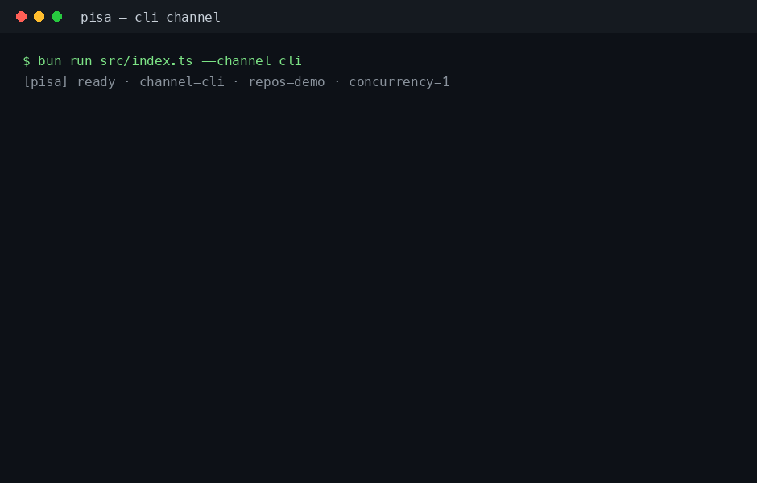
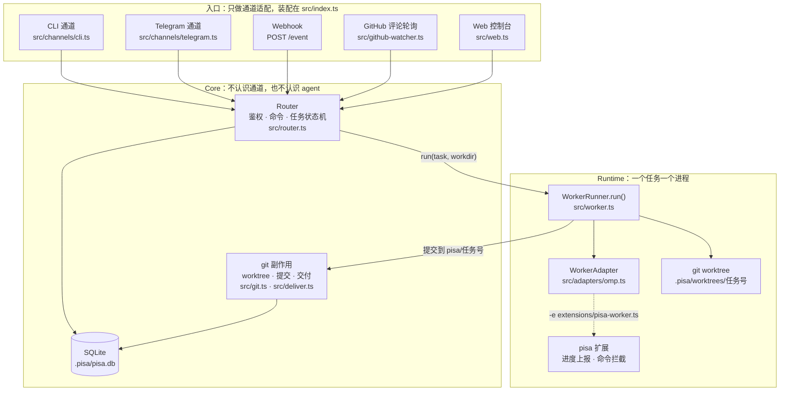

<div align="center">

# PISA

**Pi Super Agent** · 常驻在你机器上的编码 Agent 调度器

一句话接活，多个隔离 Worker 并行改代码，结果落到分支和 PR

[](https://github.com/qqlzfmn/pisa/actions/workflows/ci.yml)
[](./LICENSE)
[](https://bun.sh)
[](./tsconfig.json)

[30 秒上手](#30-秒上手) · [它是什么](#它是什么) · [架构](#架构) · [三个真实场景](#三个真实场景) · [边界](#与云端-agent-的边界) · [FAQ](#faq)

</div>



演示跑的是真实 CLI 通道与真实回执格式；Worker 换成了一段 stub 脚本，省掉模型思考的几十秒，链路与真实任务一致。

## 三类读者

| 你是 | 从哪进 | 大约耗时 |
| --- | --- | --- |
| **使用者**：想让它替自己改代码 | [30 秒上手](#30-秒上手) → [配置与运维](./docs/operations.md) → [场景与边界](./docs/usage.md) | 10 分钟 |
| **贡献者**：想改 pisa 本身 | [CONTRIBUTING](./CONTRIBUTING.md) → [SDD 流程](./SDD.md) → [架构文档](./docs/architecture.md) | 30 分钟 |
| **好奇者**：想先看设计取舍 | [它是什么](#它是什么) → [架构](#架构) → [与云端 Agent 的边界](#与云端-agent-的边界) | 5 分钟 |

## 它是什么

单个编码 Agent 已经很强，但它绑在一个会话上：

- 同时推进三件事，就得在三个窗口间来回切，进度自己记
- 上一条命令没跑完，下一条只能等
- 设备一休眠，任务就停
- 不同任务的上下文混在一个会话里，互相污染

**单任务的上限取决于模型，多任务的上限取决于人的注意力。** PISA 把这层限制从人身上挪到系统里：

| 特征 | 含义 |
| --- | --- |
| **连续** | IM 里定方案 A、PR 评论里改成方案 B，它接得上，不用管背后开了几个会话 |
| **高效** | 上一条没结束，下一条随时能进；并发上限可配 |
| **隔离** | 一个任务一个 git worktree、一个分支，上下文不串 |
| **持久** | 常驻进程，崩溃自动拉起；中断的任务可从原分支续跑 |
| **可撤销** | 交付动作记在账本里，`/pisa rewind` 预览并回退 |

没有单个 ReAct 循环能同时给出这五点，它们只能来自循环之外的系统架构。

## 30 秒上手

前置：Bun（CI 固定 1.4.4）、git，以及一个能跑起来的 coding agent CLI（默认适配器是 `omp`，`src/adapters/`）。

```bash
git clone https://github.com/qqlzfmn/pisa.git && cd pisa
bun install

# 最小配置：只管当前仓库，白名单里只有你自己
cat > pisa.config.json <<JSON
{
  "whitelist": { "users": ["$USER"], "repos": ["pisa"] },
  "repos": [{ "alias": "pisa", "path": ".", "baseBranch": "main" }]
}
JSON

# 起服务，注入一行需求
bun run src/index.ts --channel cli
```

看到 `[pisa] ready · channel=cli · repos=pisa` 就是起来了，接着输入：

```
/pisa 在 README 末尾加一行 "wake up"
```

任务执行期间在 `.pisa/worktrees/<任务号>` 里跑（结束后清理），改完提交到 `pisa/<任务号>` 分支，主分支不动。`/status` 看板，`/pisa examples` 看可直接照抄的场景。

其余通道（Telegram、webhook、GitHub 评论、定时任务、Web 控制台）与全部配置项见 [配置与运维](./docs/operations.md)。

## 架构



| 层 | 代码 | 职责 | 刻意不做 |
| --- | --- | --- | --- |
| 入口 | `src/index.ts`、`src/channels/`、`src/web.ts` | 把外部消息翻成 `IncomingMessage`，把回执写回来源 | 不做调度、不碰数据库细节 |
| Core | `src/router.ts`、`src/store.ts` | 鉴权、命令、状态机（queued → running → succeeded/failed/paused）、去重、账本 | 不认识 Telegram 与 omp |
| Runtime | `src/worker.ts`、`src/adapters/`、`extensions/` | 起进程、喂 prompt、收进度、超时与卡死判定 | 不改任务状态 |
| 交付 | `src/git.ts`、`src/deliver.ts` | worktree、提交、push、PR 链接 | 不判断任务成功与否 |

Core 与 Runtime 之间只有一个 `WorkerRunner.run()`；换成别的 agent 只需实现 `WorkerAdapter`（`src/adapters/types.ts`），Router 一行不改。分层依据与失败模式见 [docs/architecture.md](./docs/architecture.md)。

## 三个真实场景

### 1. 本地一句话派活

2026-11-18 的实跑记录（Worker 用 stub 脚本，回执格式与真实任务相同）：

```
❯ /pisa 给 README 加一节「安装」，并补一条测试
已接单 · t_20261118_79f103
仓库：demo
排队中。
开始执行 · t_20261118_79f103
分支 pisa/t_20261118_79f103
🛠 bun test 2>&1 | tail -5
✅ t_20261118_79f103 完成

已在 README.md 增加「安装」一节。
验证：bun test 通过（0 fail）。

改动 1 个文件：README.md

分支：pisa/t_20261118_79f103
```

`/status` 随后变成 `成功 · 5s · demo · 给 README 加一节「安装」，并补一条测试`。

### 2. CI 失败自动开单

CI 里加一步，把失败丢给 webhook（`webhook.enabled: true`，token 由 `PISA_WEBHOOK_TOKEN` 提供）：

```bash
curl -X POST http://127.0.0.1:8799/event \
  -H "x-pisa-token: $PISA_WEBHOOK_TOKEN" \
  -H "Content-Type: application/json" \
  -d '{"prompt":"跑测试并修掉失败","eventId":"ci:12345"}'
```

预期输出（实跑）：

```json
{"ok":true,"eventId":"ci:12345","taskId":"20261118-143001-a1b2"}
```

回执里的 `taskId` 就是跟踪依据：`events` 已落库才返回，按 `eventId` 反查也不会落空。程序化派单不去猜——同一 `eventId` 重投只建一个任务；同一仓库里需求完全相同、任务还在排队/执行/暂停时，直接复用原任务并返回它的 `taskId`，不建新任务。带同一个 `threadKey`（业务单号）的投递跨入口命中同一个任务，编辑后的新版本按 `version` 归到原任务。回执发给 `webhook.chatId`：配了 Telegram 就推到那个会话，跑本地 CLI 通道时直接打到终端。

### 3. PR 评论里继续改

在已有 PR 的评论里：

```
/pisa 把空状态提示改成中文，别动其它文案
```

预期回执（节选）：

```
已接单 · t_20261118_c3f8a1
仓库：pisa
开始执行 · t_20261118_c3f8a1
分支 pisa/t_20261118_4f0d2e
```

分支出自原 PR 的任务，不新开分支、不新建 PR，改动直接落到原 PR；完成后在原讨论串回帖（前提是开了 `delivery.push: true`，否则改动只留在本地分支）：

```
**pisa** 任务完成

<摘要，最多 3000 字>
```

更多可直接照抄的触发语句见 `/pisa examples`，或者 [skills/pisa/references/scenarios.md](./skills/pisa/references/scenarios.md)。

## 与云端 Agent 的边界

| | **pisa** | **CNB CodeBuddy NPC** | **GitHub Copilot cloud agent** |
| --- | --- | --- | --- |
| 跑在哪 | 你自己的机器，一个常驻进程 | CNB 云原生构建流水线 | GitHub Actions 支撑的临时环境 |
| 代码在哪 | 任意本地 git 仓库；远程可以是 GitHub、自建，也可以没有 | 必须托管在 CNB | 必须托管在 GitHub |
| 怎么触发 | IM、webhook、GitHub 评论、cron、CLI、Web 控制台 | Issue / PR 评论 `@CodeBuddy`，或平台 API | 指派 issue、PR 里 `@copilot`、Agents 面板 |
| 模型与运行时 | 你装了什么用什么，`worker.adapter` 可换 | CodeBuddy 模型，可配镜像与角色 | Copilot 订阅内的模型 |
| 并行与隔离 | 并发上限可配，每任务一个 worktree + 分支 | 平台侧并发 | 一个任务一条分支、一个 PR；单会话最长 59 分钟 |
| 权限面 | 你的账号与本地环境，无沙箱 | 委托代理：限时、限本仓库、权限上限 Developer | 仓库权限 + Actions secrets，受分支保护约束 |
| 恢复与回溯 | 中断任务从原分支续跑；账本支持 rewind | 流水线日志 / 平台记录 | 会话记录与 PR 历史 |
| 适合 | 自托管、私有 token、跨平台仓库、想换模型、长期常驻 | 代码已在 CNB、要开箱即用 | 代码已在 GitHub、要零运维 |

三者不互斥：pisa 也能把 GitHub 评论当入口（`github.enabled`），区别在任务跑在自己的机器上、权限面是你本机的权限，而不是平台签发的临时令牌（[CNB NPC 文档](https://docs.cnb.cool/zh/build/npc.html)、[Copilot cloud agent 文档](https://docs.github.com/en/copilot/concepts/agents/coding-agent/about-coding-agent)）。

## FAQ

**Q：和直接在终端里跟 agent 对话有什么不同？**
对话是串行的、上下文共享的。pisa 把「接活、排队、隔离、回执、记账」搬进系统：多个任务并行、各自 worktree、结果落分支，人只做验收。

**Q：会自己 push 或开 PR 吗？**
默认不。`delivery.push` 与 `delivery.pr` 都关着，改动只留在本地 `pisa/<任务号>` 分支；打开后才 push 到 origin（在本地裸仓库上验证过），`gh pr create` 还没在真实远程仓库实测。

**Q：两个任务同时改一个仓库会互相覆盖吗？**
不会。每任务一个 git worktree 与独立分支。同一分支被别的 worktree 占用时任务直接失败，不会另建同名分支顶替；续跑才会刻意共享父任务的分支。

**Q：密钥会不会被 agent 读走？**
Worker 只拿到 `worker.envAllow` 列出的环境变量（默认 PATH、HOME、LANG、LC_ALL、TERM、TMPDIR、SHELL、USER），其余变量不进子进程。但 pisa 不是沙箱：进程能读写整台机器，别在不可信仓库上开自动推送。

**Q：能跑在 Linux 服务器上吗？**
代码里没有 macOS 专有依赖；常驻脚本只提供了 macOS launchd 版本（`scripts/install-launchd.sh`），Linux 用 systemd/pm2 之类托管 `bun run src/index.ts` 即可。

**Q：能换模型或换 agent 吗？**
`worker.adapter` 决定用谁执行，目前只有一个 `omp` 适配器。换 agent 只需实现 `WorkerAdapter`（`src/adapters/types.ts`：拼参数、备环境、解析一行输出）并注册到 `src/adapters/index.ts`，Router 一行不改；换模型改对应 CLI 的配置即可。

**Q：任务跑飞了怎么收场？**
`/pisa cancel <任务号>` 停执行；`/pisa rewind <任务号>` 预览并撤销已交付的副作用；单任务 `timeoutSec` 与「无输出 `idleTimeoutSec`」会兜住卡死。

## 已知限制

- **无沙箱**：Worker 以你的身份运行，能访问整机与网络；只在你信任的仓库上开自动执行
- **回滚不完整**：账本只覆盖分支、push、PR；任务期间调用的 API、发的消息、改的数据库不会撤销
- **单机单进程**：没有分布式调度，并发受本机 CPU 与 agent 进程数限制
- **没有真正的会话持久化**：续跑靠「上一轮分支 + 上下文注入」，不是恢复 token 流
- **`gh pr create` 未实测**：没配远程的仓库只得到 compare 链接
- **常驻脚本仅覆盖 macOS launchd**：其它系统需要自己托管进程

## 文档地图

| 文档 | 内容 |
| --- | --- |
| [docs/operations.md](./docs/operations.md) | 全部配置项、IM/CLI 命令、事件入口、撤销、数据保留、常驻 |
| [docs/usage.md](./docs/usage.md) | 使用场景、最佳实践、能力边界、卡住排查 |
| [docs/architecture.md](./docs/architecture.md) | 分层、状态机、数据流、扩展点、失败模式与设计取舍 |
| [docs/specs/](./docs/specs/) | 每个 feature 的 spec / plan / tasks |
| [skills/pisa/](./skills/pisa/) | 给 agent 用的 skill：命令表、brief 模板、失败模式、可复制场景 |
| [SDD.md](./SDD.md) · [AGENTS.md](./AGENTS.md) | 规格驱动开发流程与工程规范 |

## 开发

规格驱动：`specify → plan → tasks → implement → converge`。规格是唯一事实源，改代码前先改规格；先写失败测试，再写实现。

```bash
bun test              # 单元与集成测试
bunx tsc --noEmit     # 类型检查
```

分支、提交与评审规范见 [CONTRIBUTING.md](./CONTRIBUTING.md)；部署前先读 [SECURITY.md](./SECURITY.md) 的信任边界，漏洞不要开公开 Issue；版本变更见 [CHANGELOG.md](./CHANGELOG.md)。

## 致谢

- 架构思路来自 DeepSeek Harness 团队《Super-agent 设计探索：迈向更自主的 Agent 系统》（2026-10-31）
- 底座 [pi](https://github.com/earendil-works/pi) —— 会话、工具与扩展运行时
- 规格流程参考 [GitHub spec-kit](https://github.com/github/spec-kit/blob/main/spec-driven.md)

## 许可

[MIT](./LICENSE)
