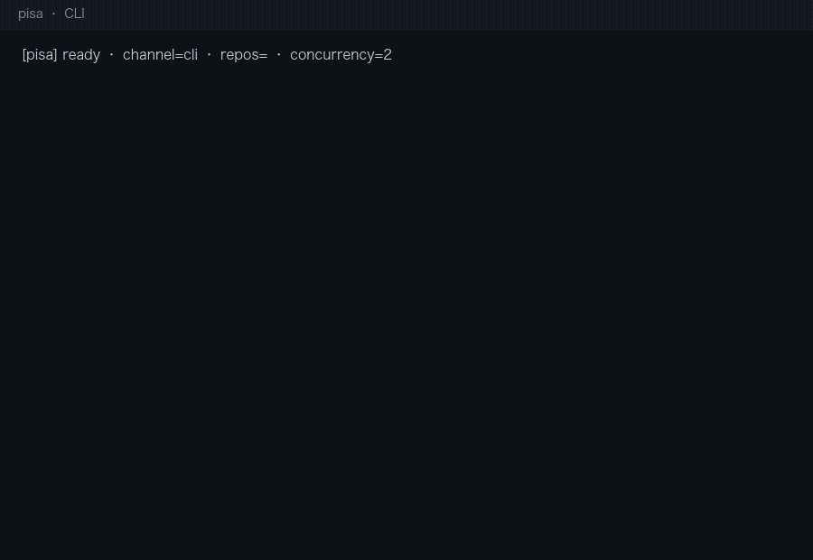
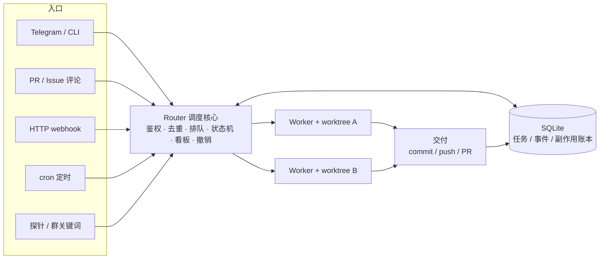

<div align="center">

# PISA

**Pi Super Agent** · 把编码 Agent 从「一个会话」变成「一个常驻团队」

[](https://github.com/qqlzfmn/pisa/actions/workflows/ci.yml)
[](LICENSE)
[](https://bun.sh)

IM、PR 评论、CI 失败、定时任务都能直接派活；每个任务在自己的 git worktree 里执行，可排队、可续跑、可撤销，任务之间不串上下文。

[30 秒上手](#30-秒上手) · [架构](#架构) · [真实场景](#三个真实场景) · [与云-agent-的边界](#与云-agent-的边界) · [FAQ](#faq) · [已知限制](#已知限制)

</div>



| 你是 | 走这条线 |
| --- | --- |
| 想先用起来 | [30 秒上手](#30-秒上手) → [配置参考](#配置参考) → [命令速查](#命令速查) |
| 想改代码 | [架构](#架构) → [开发](#开发) → [docs/specs](docs/specs) |
| 想判断值不值得用 | [三个真实场景](#三个真实场景) → [与云-agent-的边界](#与云-agent-的边界) → [已知限制](#已知限制) |

## 它解决什么问题

单个编码 Agent 已经很能干，但被绑在**一个会话**上：同时推进三件事要在窗口间切换、自己记进度；上一条命令没跑完，下一条只能等；设备休眠任务就停；不同任务的上下文互相污染。

结果：**单任务的上限取决于模型，多任务的上限取决于人的注意力。**

pisa 把这层限制从人身上移到系统里。会话管理、任务分派、中断恢复由系统负责，人只负责目标设定和结果验收。

| 特征 | 含义 |
| --- | --- |
| **连续** | 在 IM 里定方案 A，在 PR 评论里改成方案 B，接得上，不用管背后开了几个会话 |
| **高效** | 上一条任务没结束，下一条随时能进；并发上限可配 |
| **主动** | 监听群关键词、探针、PR 评论、cron，值得处理就处理 |
| **持久** | 常驻进程，崩溃自动拉起；中断任务可恢复到原分支 |

核心判断：没有任何单个 ReAct 循环能同时提供这四个特征，它们必须来自循环之外的系统架构。

## 30 秒上手

前置：**Bun**（在 1.4.4 验证）、PATH 里有 **`omp`**（Oh My Pi，Agent 运行时）。可选：`gh`（建 PR）、Telegram bot token（IM 入口）。

```bash
git clone https://github.com/qqlzfmn/pisa.git
cd pisa
bun install
bun run src/index.ts --channel cli
```

启动后直接在同一个终端里输入：

```
/pisa help
```

CLI 通道不需要 token，用来验证进程、数据库和命令链路。要真正接任务，复制配置模板并填两个值：

```bash
cp pisa.config.example.json pisa.config.json
```

最小可用配置（`whitelist.users` 在 CLI 模式下是当前系统用户名，`repos[].path` 是目标仓库绝对路径）：

```json
{
  "trigger": "/pisa",
  "whitelist": { "users": ["<你的系统用户名>"], "repos": ["pisa"] },
  "repos": [{ "alias": "pisa", "path": "/absolute/path/to/repo", "baseBranch": "main" }],
  "worker": { "adapter": "omp", "command": "omp", "timeoutSec": 3600, "extraArgs": [], "concurrency": 2 },
  "delivery": { "push": false, "pr": false, "commitName": "pisa", "commitEmail": "pisa@localhost" },
  "channels": { "cli": true },
  "stateDir": ".pisa"
}
```

```bash
bun run src/index.ts --channel cli
```

```
/pisa 修复登录超时，补一个回归测试
```

任务在 `.pisa/worktrees/<任务号>` 里执行，分支名 `pisa/<任务号>`，主工作区不动。`delivery.push`/`delivery.pr` 打开后才会推分支、建 PR。

<details>
<summary>改用 Telegram（IM 常驻）</summary>

```bash
export PISA_TELEGRAM_TOKEN="<bot token>"
```

```json
{
  "channels": { "telegram": { "enabled": true, "tokenEnv": "PISA_TELEGRAM_TOKEN" } },
  "whitelist": { "users": ["<telegram user id>"], "repos": ["pisa"] }
}
```

```bash
bun run src/index.ts
```

私聊直接说需求，不用触发词；群聊需要 `/pisa <需求>`。启动时会注册命令菜单（`setMyCommands`）。

</details>

## 架构



| 层 | 代码 | 职责 |
| --- | --- | --- |
| 入口 | `src/index.ts` | 读配置、建 Store/Router/事件源、启动通道与 webhook |
| 调度核心 | `src/router.ts` | 归一条消息：鉴权、命令解析、事件去重、排队、并发补位、`merge`/`rewind` |
| 状态 | `src/store.ts` | SQLite：任务、事件占位、消息→任务映射、副作用账本 |
| 执行运行时 | `src/worker.ts`、`src/adapters/*`、`extensions/pisa-worker.ts` | 拉起 Agent 进程、超时/取消、解析输出，扩展负责进度上报与命令拦截 |
| 事件源 | `src/proactive.ts`、`src/github-watcher.ts`、`src/scheduler.ts`、`src/index.ts` | 群关键词、探针、PR 评论轮询、cron、HTTP webhook |
| 交付 | `src/deliver.ts`、`src/git.ts` | 建 worktree、提交、推送、创建 PR、退回 compare 链接 |
| 通道 | `src/channels/cli.ts`、`src/channels/telegram.ts` | 收发消息，回执里带消息 id 用于续跑 |

一次任务的生命周期：

```
消息 → 鉴权 → claimEvent 去重 → 建任务 queued
     → 并发有空位 → 建 worktree + 分支 pisa/<id>（running）
     → omp 执行 → 进度写 jsonl → Router 节流转发到对话
     → 交付 commit（可选 push/PR）→ succeeded
```

`pisa.config.json` 里 `worker.adapter` 决定执行层；当前注册表只有 `omp`，加一个适配器就能换运行时（`src/adapters/index.ts`）。pisa 不 fork pi，Worker 以「pi 进程 + 扩展」的方式接入。

中断与终态：进程重启时，工作副本和会话 id 都在的 `running` 任务转 `paused`，可用 `resume` 拉回；缺任一条的标 `failed`。取消、失败、成功、撤销都走同一套状态机（`src/types.ts` 的 `ALLOWED`）。

## 三个真实场景

### 1. 一条 IM 需求，长出一个 PR

```
你（私聊）：/pisa status 的「最近完成」看不出是哪一条任务，补上任务号
pisa：已接单 · t_20261118_9f61e9
      仓库：pisa
      排队中。

pisa：开始执行 · t_20261118_9f61e9
      分支 pisa/t_20261118_9f61e9

pisa：🛠 rg "最近完成" src/router.ts
pisa：✏️ Edit src/router.ts
pisa：🛠 bun test tests/router.test.ts

pisa：✅ t_20261118_9f61e9 完成
      完成行现在以任务号开头，可以直接拿去 /pisa rewind 或 merge；补了一个断言。

      改动 2 个文件：src/router.ts, tests/router.test.ts

      分支：pisa/t_20261118_9f61e9

      链接：https://github.com/qqlzfmn/pisa/pull/12

      会话：a1b2c3d4
```

预期：主工作区没有任何改动；PR 正文带任务号和原始需求。前提是 `delivery.push`、`delivery.pr` 为 `true` 且 `gh` 已认证。

### 2. 在 PR 评论里接着改

```
评审人（PR #12 评论）：/pisa 「最近完成」为空时的 (无) 还没有断言，补一个
pisa：已接单 · t_20261119_3c7d1a
      仓库：pisa
      排队中。

pisa：✅ t_20261119_3c7d1a 完成
      补了空看板时「最近完成」显示 (无) 的断言。

      改动 1 个文件：tests/router.test.ts

      分支：pisa/t_20261118_9f61e9

      链接：https://github.com/qqlzfmn/pisa/pull/12
```

预期：不新建分支、不新建 PR。PR 上已有成功任务时，新任务复用它的分支和 `prUrl`；完成后摘要回帖到该 PR。普通 Issue 评论则从主干开新分支，PR 里追加 `Closes #<n>`。

### 3. CI 失败，无人 @ 也接手

探针模式：定时跑一条命令，退出码非 0 就开单。

```json
{
  "proactive": {
    "probe": {
      "enabled": true,
      "command": "gh run list --limit 1 --json conclusion -q '.[0].conclusion' | grep -q success",
      "intervalSec": 300,
      "chatId": "<telegram chat id>",
      "userId": "<telegram user id>",
      "repo": "pisa",
      "prompt": "CI 有失败，定位原因并修复"
    }
  }
}
```

```
pisa：已接单 · t_20261119_77aa02
      仓库：pisa
      排队中。
```

也可以从外部直接投递（CI 脚本、监控、cron）。开启 webhook，回执发到 `chatId` 指定的对话：

```json
{
  "webhook": {
    "enabled": true,
    "port": 8799,
    "tokenEnv": "PISA_WEBHOOK_TOKEN",
    "chatId": "<telegram chat id>",
    "userId": "<telegram user id>"
  }
}
```

```bash
export PISA_WEBHOOK_TOKEN="<随机串>"
curl -X POST http://127.0.0.1:8799/event \
  -H "x-pisa-token: $PISA_WEBHOOK_TOKEN" \
  -H "Content-Type: application/json" \
  -d '{"prompt":"跑测试并修掉失败","eventId":"ci:12345"}'
```

同一个 `eventId` 重复投递只建一个任务；`repo` 可指定别名。

## 与云 agent 的边界

| 维度 | pisa | CNB NPC | GitHub Copilot coding agent |
| --- | --- | --- | --- |
| 执行位置 | 你自己的机器或服务器，本地 git worktree | CNB 平台托管的云构建环境 | GitHub Actions 托管沙箱 |
| 触发方式 | IM 私聊/群、PR/Issue 评论、HTTP webhook、cron、探针 | 平台内 Issue / PR / 分支对话 | 分配 Issue、PR 里 @copilot |
| 模型与工具链 | 自己选，`worker.command` 换成任意 omp 支持的模型 | 平台提供 | GitHub 托管，不可替换 |
| 上下文 | 任务级隔离；续跑靠父任务分支 + 上下文注入 | 平台会话 | 单任务会话，可在同一 PR 上迭代 |
| 交付 | 本地分支，可选 push / PR | 平台内 PR | GitHub PR |
| 撤销 | `rewind` 读副作用账本，按任务回滚分支/PR/合并 | 无统一账本 | 手动关闭 PR 或回退 |
| 运维成本 | 自己维护进程、机器、权限边界 | 平台托管 | 平台托管 |
| 适用 | 私有依赖、内网、自举、自定义模型与策略 | 已在 CNB 上协作的仓库 | GitHub 上轻量修复与小改动 |

pisa 明确不做的事：

- **不是托管服务**：没有多租户、没有云端沙箱。Worker 以本机用户权限运行，安全边界是白名单（用户/仓库）、webhook token 和命令拦截，不是容器隔离。
- **不替代 CI**：它消费 CI 的结果，不负责构建矩阵与制品。
- **不做代码评审模型**：评审意见来自人和外部工具，pisa 只负责把意见变成任务。

## FAQ

**和「开一个长会话让 Agent 连续做」有什么差别？**
长会话里所有任务的上下文共享，一个任务的失败会污染下一个；并行只能靠人排队。pisa 一个任务一个 worktree、一份上下文，失败互不影响，并发由 `worker.concurrency` 控制。

**换模型要改哪里？**
改 `worker.command` 与 `worker.extraArgs`，它们原样传给 omp。pisa 不碰模型适配层。

**能跑在 Linux 服务器上吗？**
可以，`scripts/supervise.sh` 只做「崩溃拉起」，用 systemd 包一层即可；仓库自带的安装脚本只覆盖 macOS launchd。

**数据存在哪？**
`stateDir`（默认 `.pisa/`）：`pisa.db` 是 SQLite，`worktrees/` 是任务工作副本，`progress/` 是实时进度，`logs/` 是任务日志。删库等于丢任务历史，工作副本会变成孤儿目录。

**进程重启，跑到一半的任务会丢吗？**
工作副本和会话 id 都在的任务转 `paused`，用 `/pisa resume <任务号>` 接着跑；缺任一条的标 `failed`，日志里保留原因。

**会污染主干吗？**
任务只写 `pisa/<任务号>` 分支；`delivery.push` 默认关闭；合并必须显式 `/pisa merge <任务号>`，在临时副本跑完 `bun test` 才 `--ff-only` 合入。

**怎么撤销一个任务？**
`/pisa rewind <任务号>` 先给预览：将关闭的 PR、将删除的本地/远程分支、是否已合并、哪些动作不可撤销。加 `--yes` 执行；已合并的任务用 revert 提交回退，不改写历史。

**需要公网 IP 吗？**
不需要。webhook 只监听 `127.0.0.1`；GitHub 评论用主动轮询，不需要回调地址。

**多个仓库怎么分？**
`repos` 配多条，入口写 `@别名 <需求>`；别名可以放在触发词前后，写错不会被吞掉。

## 已知限制

- **会话恢复不是真正的会话持久化**：靠「上一轮分支 + 上下文注入」续跑，进程内的推理状态不会恢复。
- **PR 依赖 `gh` CLI**：分支 push 和建 PR 都由 `gh` 完成；`gh` 不可用时退回 compare 链接，没有改用 API token 的路径。
- **单机单实例**：SQLite + 本地 worktree，多台机器共享同一仓库会互相踩，没有分布式锁。
- **只有 omp 适配器**：换运行时需要新写 `src/adapters/<name>.ts` 并注册。
- **撤销有边界**：`rewind` 只覆盖账本内的分支、push、PR、合并；任务期间调用的外部 API、发出的消息无法回滚。
- **定时任务依赖进程常驻**：按进程本地时区计算，进程不在就不会触发。
- **Telegram 只有长轮询**：单 bot 单进程；GitHub 评论作者不参与鉴权，任务归属由配置里的 `chatId`/`userId` 决定。
- **没有沙箱**：命令拦截是策略层（`extensions/pisa-worker.ts` 的正则清单），不是内核隔离，不能替代容器。

## 开发

```bash
bun install
bun test            # 128 个测试
bunx tsc --noEmit   # 类型检查
```

本项目使用规格驱动开发（SDD），流程见 [SDD.md](./SDD.md)：

```
specify → plan → tasks → implement → converge
```

- 规格是唯一事实源，改代码前先改规格；每条需求有 ID（`US-1` / `FR-001` / `NFR-001`）
- 一个 feature 一个目录：`docs/specs/<编号>-<名称>/`
- 工程规范见 [AGENTS.md](./AGENTS.md)：SSOT、深度封装、插件化、日志可观测、禁止技术债

```
pisa/
├── src/                 # Router、事件源、Worker、存储、通道
│   ├── router.ts        # 调度核心
│   ├── worker.ts        # 执行运行时
│   ├── adapters/        # Agent 适配器注册表
│   ├── channels/        # CLI、Telegram
│   └── ...
├── extensions/          # pi 扩展：进度上报 + 命令拦截
├── scripts/             # supervise.sh、launchd 安装
├── docs/specs/          # 每个 feature 的 spec / plan / tasks
└── tests/               # bun test
```

## 命令速查

<details>
<summary>全部命令与触发方式</summary>

```
/pisa <需求>                       接一个任务（私聊可直接说需求）
/pisa @别名 <需求>                  指定仓库
/pisa status                      任务看板（私聊 /status）
/pisa cancel [任务号]               取消（私聊 /cancel）
/pisa resume <任务号>               恢复被进程重启中断的任务（私聊 /resume）
/pisa continue <任务号> <新要求>     接着上一轮的分支做
/pisa merge <任务号>                验证后合并到主干（自举）
/pisa rewind <任务号> [--yes]       预览/执行撤销
/pisa schedules                   定时任务列表（私聊 /schedules）
/pisa confirm                     确认被拦下的单英文词任务
/pisa help                        帮助（私聊 /help）
```

- **回复机器人的任意一条任务消息 = 继续那个任务**，不用记任务号
- 单英文词（如 `/pisa refactor`）先要求确认，10 分钟内 `/pisa confirm` 生效；与已知命令编辑距离 ≤ 2 的单词（如 `/pisa stats`）只给命令建议，不建任务
- `continue` 只允许原请求者；续跑固定在父任务所在仓库

</details>

## 配置参考

<details>
<summary>pisa.config.json 全部字段</summary>

| 字段 | 说明 |
| --- | --- |
| `trigger` | 触发词，默认 `/pisa`；也可用 `PISA_TRIGGER` 覆盖 |
| `dmWithoutTrigger` | 私聊不带触发词也当任务，默认 `true` |
| `whitelist.users` / `whitelist.repos` | 允许的用户 id 与仓库别名，不在白名单的请求被拒绝 |
| `repos[]` | `alias`、`path`（绝对路径）、`baseBranch`、可选 `remote` |
| `worker` | `adapter`（当前仅 `omp`）、`command`、`extraArgs`、`timeoutSec`、`concurrency` |
| `delivery` | `push` 推分支、`pr` 建 PR、`commitName`/`commitEmail` 提交身份 |
| `channels.cli` | 启用 stdin/stdout 通道 |
| `channels.telegram` | `enabled`、`tokenEnv`、`proxy` |
| `webhook` | `enabled`、`port`（仅 127.0.0.1）、`tokenEnv`、`chatId`、`userId` |
| `github` | `enabled`、`intervalSec`、`tokenEnv`、`repos[]`（`repo`/`chatId`/`userId`） |
| `scheduler` + `schedules[]` | 定时任务的发送方身份与 cron 列表（`id`、`cron`、`prompt`、`repo`、`enabled`） |
| `proactive.keywords` | 群关键词开单：`words`、`cooldownSec`、`chatId`、`userId`、`prompt` |
| `proactive.probe` | 命令探针：`command`、`intervalSec`、`cooldownSec`、`repo`、`prompt` |
| `stateDir` | 状态目录，默认 `.pisa`，可用 `PISA_STATE_DIR` 覆盖 |

优先级：`pisa.config.json` 覆盖默认值，环境变量再覆盖 `trigger`/`users`/`stateDir`。

</details>

<details>
<summary>定时任务（cron）</summary>

```json
{
  "scheduler": { "chatId": "<telegram chat id>", "userId": "<telegram user id>" },
  "schedules": [
    { "id": "morning", "cron": "0 9 * * 1-5", "prompt": "检查昨天以来的 CI 失败并修复", "repo": "pisa" }
  ]
}
```

- 5 段 `分 时 日 月 周`，本地时区；支持 `*`、`*/n`、逗号列表、`a-b`、`a-b/n`，周 `7` 等同周日
- 每 30 秒检查一次，同一分钟只投一次，进程重启不重投
- `scheduler` 缺失时 `schedules` 不生效；非法 cron 或重复 `id` 启动时告警并跳过

</details>

<details>
<summary>GitHub 评论入口</summary>

```json
{
  "github": {
    "enabled": true,
    "intervalSec": 120,
    "tokenEnv": "GH_TOKEN",
    "repos": [{ "repo": "owner/pisa", "chatId": "<chat id>", "userId": "<user id>" }]
  }
}
```

- 默认 120 秒轮询 Issue 评论（PR 评论走同一接口），只认正文以 `/pisa ` 开头的评论
- 启动时刻为下界，不回放历史；按「仓库 + 评论 id」去重，重启不重复建单
- 评论所在 PR 已有成功任务时复用分支、更新原 PR；Issue 评论从主干开新分支，PR 带 `Closes #<n>`
- 完成后摘要（≤3000 字）回帖到来源仓库；回帖失败只写日志，不改任务状态

</details>

<details>
<summary>自举：让 pisa 改自己</summary>

1. 发需求，Worker 在 `pisa/<任务号>` 上改代码
2. `/pisa merge <任务号>`：临时副本跑 `bun test`，通过后 `--ff-only` 合入 `main`
3. 看护模式（`PISA_SUPERVISED=1`）下进程退出，`scripts/supervise.sh` 拉起新代码

</details>

<details>
<summary>常驻（launchd，macOS）</summary>

```bash
./scripts/install-launchd.sh     # 重复执行等于重装
tail -f ~/Library/Logs/pisa.launchd.log
launchctl print gui/$(id -u)/ai.pisa.supervisor
```

卸载：

```bash
launchctl bootout gui/$(id -u)/ai.pisa.supervisor
rm ~/Library/LaunchAgents/ai.pisa.supervisor.plist
```

token 不进 plist：`supervise.sh` 从环境变量取，缺省读 `~/.pisa/telegram_token` 与 `~/.pisa/webhook_token`。

</details>

## 致谢

- 架构思路来自 DeepSeek Harness 团队《Super-agent 设计探索：迈向更自主的 Agent 系统》（2026-10-31）
- 底座 [pi](https://github.com/earendil-works/pi)：会话、工具与扩展运行时
- 规格流程参考 [GitHub spec-kit](https://github.com/github/spec-kit/blob/main/spec-driven.md)

License: [MIT](LICENSE)
